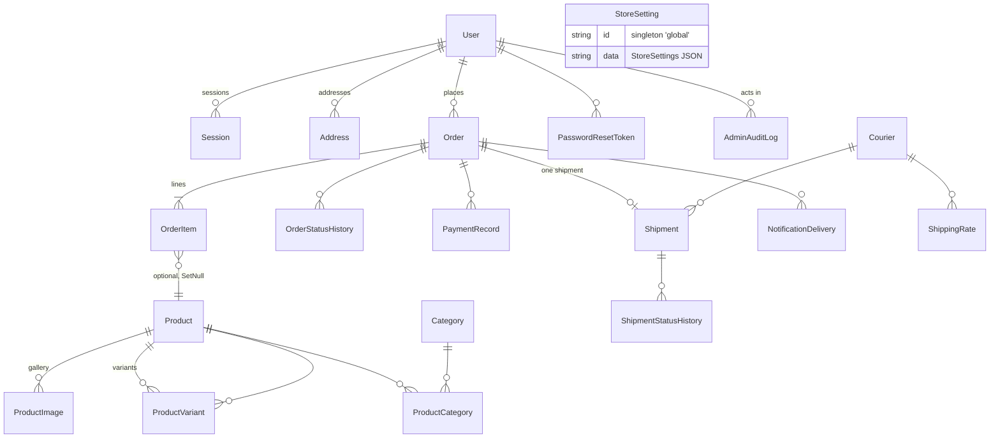

# DATABASE — Data Model Reference

Source of truth: [`prisma/schema.prisma`](../prisma/schema.prisma). All 24 models are documented below. Money is **integer minor units (cents)** in every `*Cents` field (decision D-02) — e.g. `Rp 4.290.000` is stored as `429000000`.

## 1. ER overview



Key design points:

- **Snapshotting**: `OrderItem` snapshots `name`, `sku`, `size`, `color`, `imageUrl`, `unitPriceCents` at purchase time; `Order.shippingAddress` is a JSON string snapshot. Editing/deleting products or addresses never corrupts historical orders.
- **Separation of concerns**: `Order.status` (fulfillment) and `Order.paymentStatus` (money) are independent fields; `Shipment` is 1:1 with `Order` and carries its own status history.
- **Notification isolation**: `NotificationDelivery` rows are created outside order transactions; `orderId` is `SetNull` on order delete.
- **Audit actors**: `AdminAuditLog.actor` is `SetNull` — the log survives user deletion.

## 2. Identity & Access

### User
Platform account (customer or staff).

| Field | Type | Notes |
|---|---|---|
| `id` | String (cuid) | PK |
| `email` | String | unique, lowercased by API layer |
| `passwordHash` | String | bcrypt, cost 10 |
| `name`, `phone?` | String | |
| `role` | String | `CUSTOMER \| OWNER \| ADMIN \| ORDER_MANAGER \| CONTENT_MANAGER` — validated in `src/lib/validators.ts` (`ROLES`); capabilities in `src/lib/permissions.ts` |
| `isActive` | Boolean | `false` blocks login and existing sessions (checked in `getCurrentUser`) |

Relations: sessions, addresses, orders, passwordResetTokens, auditLogs. Index: `role`.

### Session
One row per logged-in device. `token` stores the **SHA-256 hash** of the cookie value (cookie `me_session` holds the raw token). 30-day TTL. Cascade-deleted with the user.

### PasswordResetToken
Hashed token, 30-minute expiry, single-use (`usedAt`). Consumed by `POST /api/auth/reset-password`. Raw token is emailed in production installs / returned in the API response in non-production only.

### Address
Customer address book entry. `province` is matched (case-insensitively, whitespace-normalized) against `ShippingRate.region` for REGION rates. `isDefault` marks the checkout default.

## 3. Store Configuration

### StoreSetting
**Singleton** row with `id = "global"`. `data` is the JSON-serialized `StoreSettings` object (shape: `src/lib/store-settings.ts`, editable at `/webmaster/settings`). Missing keys are deep-merged over `DEFAULT_SETTINGS` on read, so schema additions never break existing rows. Secrets never go here — env vars only (D-05).

## 4. Catalog

### Category
`name`, `slug` (unique), `description?`, `imageUrl?`, `position` (ordering), `isActive`. Landing page: `/collections/[slug]`.

### Product
| Field | Notes |
|---|---|
| `slug` | unique, kebab-case (Zod-enforced) |
| `priceCents` | base price, integer cents |
| `salePriceCents?` | used only when lower than `priceCents` (`effectiveUnitPriceCents` in `src/lib/money.ts`) |
| `skuBase` | base SKU; variants carry their own unique `sku` |
| `details` | markdown (materials/care/dimensions) |
| `isFeatured`, `isNewArrival`, `isBestSeller` | homepage/listing curation flags |
| `isActive` | storefront visibility |
| `archivedAt` | soft archive; archived products are rejected at checkout |

### ProductImage
Ordered gallery (`position`), `url`, `alt?`. Cascade-deleted with the product. First image doubles as the cart/order snapshot image.

### ProductVariant
`size?`, `color?`, unique `sku`, `stock` (integer), `priceDeltaCents` (added to the product's effective unit price). **Stock is deducted transactionally at checkout** when `enforceStock` is on.

### ProductCategory
Join table `(productId, categoryId)`, composite PK, both FKs cascade.

## 5. Orders

### Order
| Field | Notes |
|---|---|
| `orderNumber` | unique, `ME-YYMM-XXXXXX` (prefix from settings) |
| `idempotencyKey` | **unique** — client-generated UUID; retries return the existing order (D-09) |
| `userId?` | null for guest checkout |
| `email/phone/customerName` | contact snapshot |
| `shippingAddress` | JSON string snapshot |
| `shippingMethod` | courier/service label snapshot |
| `shippingCostCents`, `subtotalCents`, `totalCents` | integer cents |
| `status` | see state machine below |
| `paymentStatus` | `UNPAID \| PAID_CONFIRMED \| REFUNDED` (independent of `status`) |
| `paymentMethod` | `MANUAL_TRANSFER` (default) |
| `customerNote?`, `adminNote?`, `cancellationReason?` | |
| `paidAt?`, `cancelledAt?`, `completedAt?` | timestamps |

**Order status state machine** (`ORDER_TRANSITIONS` in `src/lib/validators.ts`, enforced by `assertTransition` in `src/lib/orders.ts`):

```
PENDING_PAYMENT → PAID | CANCELLED
PAID            → PROCESSING | CANCELLED | REFUNDED
PROCESSING      → READY_TO_SHIP | CANCELLED | REFUNDED
READY_TO_SHIP   → SHIPPED | CANCELLED | REFUNDED
SHIPPED         → COMPLETED
COMPLETED       → REFUNDED
CANCELLED, REFUNDED → (terminal)
```

Any other transition is rejected with HTTP 409. Equal-status writes are tolerated but produce no history row.

### OrderItem
Snapshot line: `name`, `sku`, `size?`, `color?`, `imageUrl?`, `unitPriceCents`, `quantity`, `lineTotalCents`. `productId`/`variantId` are nullable references (`SetNull` on product delete).

### OrderStatusHistory
Append-only trail: `fromStatus?` → `toStatus`, `note?`, `actorType` (`SYSTEM | ADMIN | CUSTOMER`), `actorLabel?`.

### PaymentRecord
Manual-transfer payments: `amountCents`, `reference?` (bank ref / sender name), `note?`, `confirmedById?`, `confirmedAt`. Written when the webmaster confirms payment.

## 6. Shipping (manual, no courier APIs)

### Courier
`name`, `code` (unique, `^[A-Z0-9_]+$`), `description?`, `trackingUrlTemplate?` (must contain the `{trackingNumber}` placeholder when set), `minDays?`/`maxDays?` lead times, `position`, `isActive`.

### ShippingRate
| Field | Notes |
|---|---|
| `courierId` | FK, cascade |
| `name` | e.g. "Reguler", "Express Jakarta" |
| `type` | `FLAT` (use `region = "*"`) or `REGION` (matches province name, case-insensitive) |
| `region` | `"*"` or province name |
| `rateCents` | integer cents |
| `freeAboveCents?` | per-rate free-shipping subtotal threshold |

Quoting logic: `quoteShippingRates()` in `src/lib/orders.ts` — store-level `freeShippingAboveCents` (settings) takes precedence, then the per-rate `freeAboveCents`; matching rates return `rateCents: 0, freeApplied: true`.

### Shipment
1:1 with `Order` (`orderId` unique). `courierId?` + snapshot `courierName?`, `trackingNumber?`, `trackingUrl?` (built from the courier template), `status` (`PENDING | IN_TRANSIT | OUT_FOR_DELIVERY | DELIVERED | EXCEPTION | RETURNED`), `estimatedDelivery?` (human-readable, set by webmaster), `note?`.

### ShipmentStatusHistory
Append-only shipment trail (`status`, `note?`). Tracking is **manual** — statuses are never synchronized with courier systems.

## 7. Content / CMS

| Model | Purpose | Notable fields |
|---|---|---|
| `Banner` | Hero carousel slides | `imageUrl`, `mobileImageUrl?`, `ctaText?/ctaUrl?`, `position`, `isActive`, `startsAt?`/`endsAt?` scheduling |
| `ContentPage` | Static pages (`/pages/[slug]`) | `content` (sanitized Markdown), `isPublished`, `showInFooter`, `seoTitle?/seoDescription?` |
| `FaqEntry` | FAQ accordion | `question`, `answer`, `position`, `isActive` |
| `NewsletterSubscriber` | Footer signup capture | unique `email` |

## 8. Integrations & Audit

### NotificationDelivery
One row per Telegram attempt. `event` (`ORDER_CREATED | PAYMENT_CONFIRMED | ORDER_CANCELLED | SHIPMENT_ADDED | SHIPMENT_STATUS_CHANGED | LOW_STOCK | NEW_REGISTRATION | TEST | SYSTEM_FAILURE`), `status` (`PENDING → SENT | FAILED`), `target` (**masked** chat id — never the token), `payload` (JSON message snapshot), `attempts`, `lastError?`, `orderId?` (SetNull). Engine: `src/lib/telegram.ts` (3 attempts, 1.5 s × attempt backoff, 10 s timeout, 4xx≠429 fails immediately).

### AdminAuditLog
`actorId?/actorEmail?` (SetNull), `action` (e.g. `ORDER_STATUS_CHANGE`, `SETTINGS_UPDATE`, `TELEGRAM_TEST`, `OWNER_BOOTSTRAP`), `entity?`, `entityId?`, `meta?` (JSON), `createdAt`. Viewable at `/webmaster/audit`.

## 9. SQLite constraints (and why they're safe)

1. **No native enums** → status/role/type fields are `String`, validated by Zod schemas (`src/lib/validators.ts`) and, for order transitions, by the `ORDER_TRANSITIONS` map. Nothing invalid reaches the DB through the API.
2. **No scalar lists** → composite values are JSON in `String` columns: `Order.shippingAddress`, `StoreSetting.data`, `AdminAuditLog.meta`, `NotificationDelivery.payload`.
3. **No DECIMAL** → money is `Int` cents (D-02). Formatting happens at the edges: `formatMoney()` in `src/lib/money.ts`, `Intl.NumberFormat` with the settings currency/locale.
4. **Single writer** → SQLite allows one writer at a time. Checkout wraps stock checks + deduction in `db.$transaction`; under high concurrent write load consider PostgreSQL (one-line datasource switch — see `README.md`).

## 10. Migration workflow

| Command | When to use |
|---|---|
| `bun run db:push` | **Dev.** Syncs `schema.prisma` to the DB directly (uses `--accept-data-loss`; destructive changes can drop data) |
| `bun run db:generate` | After schema edits, to refresh the Prisma client (also run if the client seems stale) |
| `bun run db:migrate` | **Production path.** `prisma migrate dev` — creates SQL migration files under `prisma/migrations/` giving a reviewable, replayable history |
| `bun run db:reset` | Drops and recreates the DB from migrations (confirm prompt; dev only) |
| `bun run db:seed` | Idempotent demo seed — safe to re-run; skips rows that already exist. Dev/demo only |

Recommended production flow: develop with `db:push`, then cut a migration with `db:migrate` before deploy and apply it on the server (`prisma migrate deploy` — see `docs/DEPLOYMENT.md`). Always back up `db/custom.db` first (see `docs/BACKUP-RESTORE.md`).
